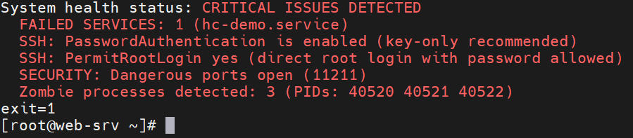
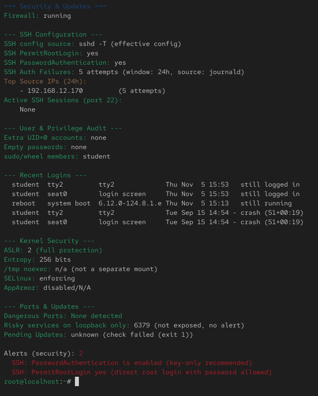
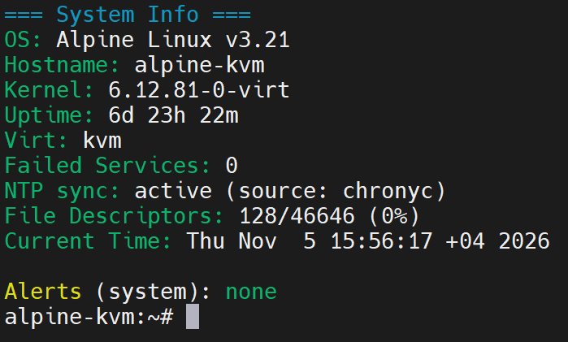
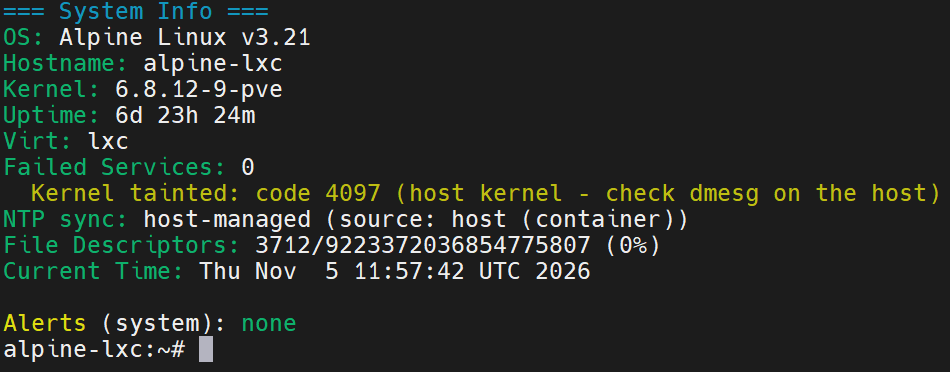
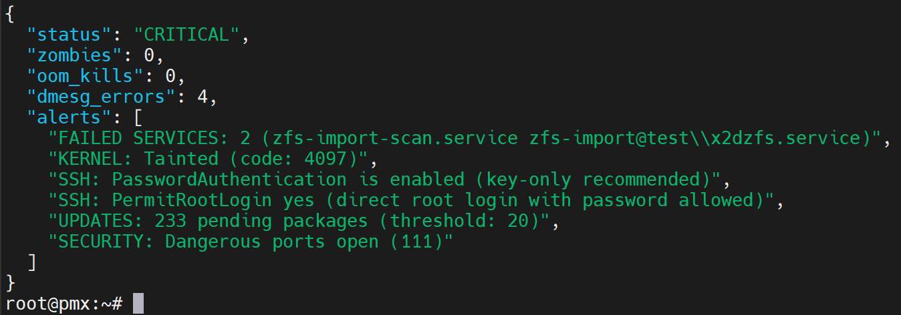
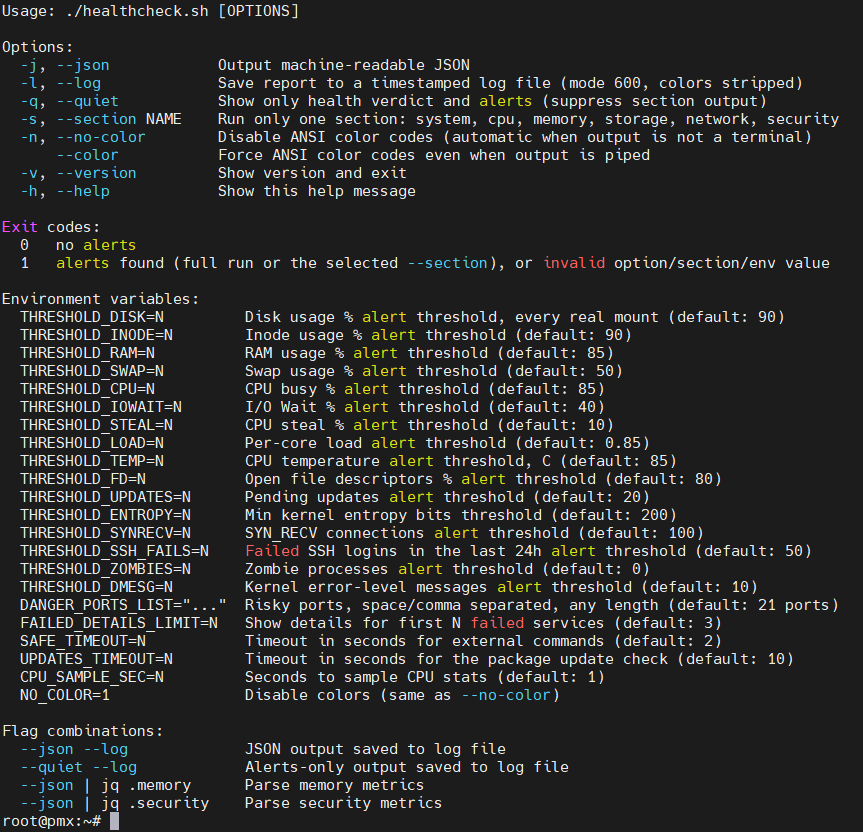
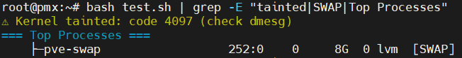
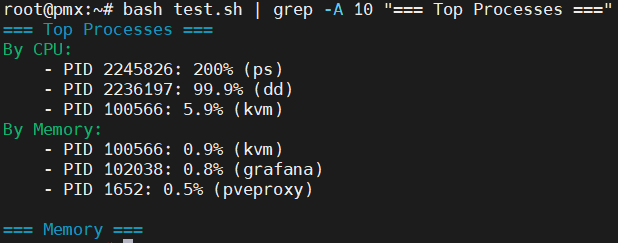

# system-healthcheck (`v0.1.6`)

[](https://opensource.org/licenses/MIT)
[](https://www.gnu.org/software/bash/)
[](https://www.linux.org/)

A lightweight Bash script for rapid server audits and health monitoring. It gives an "at-a-glance" overview of system resources, network status and security settings, with JSON output, logging and exit codes for cron and monitoring.

---

## 🔄 Changelog

### v0.1.6 (Current) - bug-fix & accuracy release

v0.1.6 is about **trust in the verdict**: correct exit codes in every mode, no false `CRITICAL` on healthy hosts, and real values instead of guesses.

#### 🐛 Fixed
- **Exit codes with `--log` and `--section`**: `--log` ran the report in a pipeline subshell, so alerts were lost and the script always exited `0`. `--section` never reported alerts at all. Both now print alerts and exit `1` when something is wrong.
- **Zombie processes from cron / SSH**: detection used `ps` without `-e` and only saw processes of the current terminal. Zombies are now read from `/proc/<pid>/stat`, so cron runs and `ssh host './healthcheck.sh -q'` find them. The script's own short-lived helpers (and BusyBox `timeout` watchers on Alpine) are not counted.
- **RX/TX totals**: `/proc/net/dev` is parsed by splitting on the interface colon first, so byte counters are correct for any counter width.
- **Time synchronization**: instead of "an NTP process exists", the real sync state is checked: `timedatectl` → `chronyc tracking` → `ntpstat` → process fallback. In containers (LXC, Docker) the clock is host-managed and no longer triggers an alert.
- **dmesg counters**: `dmesg_errors` matches `dmesg --level=err,crit,alert,emerg | wc -l` exactly (BusyBox: `dmesg -r` priorities). When dmesg is not readable (non-root + `kernel.dmesg_restrict=1`) the value is `null` instead of a misleading `0`.
- **SSH configuration**: `PermitRootLogin` / `PasswordAuthentication` / `Port` are the **effective** values: `sshd -T` as root, otherwise an `Include`-aware parser (`sshd_config.d/*.conf`, first value wins, like sshd). The source is shown in the report.
- **False CRITICAL alerts**:
  - dangerous ports bound to loopback only (`127.0.0.1`, `::1`) are listed separately and **not** alerted;
  - locked accounts (`!`, `!!`, `*` in `/etc/shadow`) are no longer reported as "empty password";
  - SSH brute-force: last **24 h** only, alert above `THRESHOLD_SSH_FAILS` (default 50) instead of "any failure ever";
  - active SSH sessions: inbound only (local port = sshd port); outgoing `ssh` is no longer listed;
  - `/tmp noexec`: `n/a` when `/tmp` is not a separate mount (was reported as `yes`);
  - OpenRC (Alpine): only the current runlevel and crashed services count as failed (shutdown-runlevel services were reported as failed);
  - containers (LXC, Docker): the host kernel's taint flag is shown but not alerted.
- **Disk usage on every mount**: disk and inode alerts for every real local filesystem (was `/` only). `tmpfs`, `devtmpfs`, snap `squashfs`, ISO images, `/run/media/*`, FUSE and network filesystems are excluded by **type**, so an LXC root on `/dev/loopN` or a ZFS dataset is still checked. The table adapts to long LVM names (`pve-vm--911--disk--0`).
- **CPU usage**: I/O wait is no longer counted as CPU busy, and `guest` time is no longer double-counted. Usage is calculated across all cores.
- **Small things**:
  - all `THRESHOLD_*` environment variables are honored (they were overwritten by hard-coded values) and validated: an invalid value exits with an error;
  - no ANSI colors when the output is piped or redirected; `--color` forces them;
  - non-root: no 1-second pause, no warnings on stderr in `--json` / `--quiet` mode;
  - locale-independent (`LC_ALL=C`): pending updates are counted correctly under `LANG=ru_RU.UTF-8` etc.;
  - `SAFE_TIMEOUT` is actually used; the update check has its own `UPDATES_TIMEOUT` and reports `null` on timeout instead of `0`;
  - failed systemd units are printed with their real name (`run-vmblock\x2dfuse.mount`), the same in the report and in the alert;
  - JSON types: `load_per_core` is a number, `temp_celsius` is a number or `null`.

#### ✨ New
- **`--color`** flag (force colors when piped, e.g. `| less -R`).
- **Alerts in JSON**: `.health.alerts[]` (full run) and `.alerts[]` (section mode).
- **New thresholds** (env): `THRESHOLD_CPU`, `THRESHOLD_STEAL`, `THRESHOLD_TEMP`, `THRESHOLD_FD`, `THRESHOLD_DMESG`, `THRESHOLD_ZOMBIES`, `THRESHOLD_SSH_FAILS`, plus `UPDATES_TIMEOUT`.
- **`DANGER_PORTS_LIST` from the environment**: validated, de-duplicated, hash-map lookup (lists of 150+ ports are fine).
- **Log files are created with mode `600`** (the report contains usernames, IPs and open ports) and named `system-healthcheck-YYYYmmdd-HHMMSS.log`.
- **OpenSSH 9.8+ support**: failed logins are also read from `sshd-session` (RHEL 10, Fedora, newer Debian/Ubuntu).
- **`selftest.sh`**: a 26-check smoke test for the release (see [Testing](#-testing)).

#### ⚠️ Behavior changes (check your automations)
- `--section` now exits `1` when that section has alerts.
- `SSH: PermitRootLogin yes` is a new alert.
- JSON: `load_per_core`, `aslr`, `entropy` are numbers; `temp_celsius`, `updates`, `ssh_failures`, `oom_kills`, `dmesg_errors` can be `null` ("unknown"); new keys are listed in [JSON output](#-json-output).
- The "Log file created" message goes to stderr.
- Requires **bash 4.4+** (all supported distributions ship 5.x).

---

### v0.1.5 (Previous Release)

- **`--no-color` flag**: Disable ANSI color codes for clean logs, CI/CD pipelines, or terminals without color support. Supports the `NO_COLOR=1` environment variable.
- **`--section NAME` mode**: Run only a specific audit section (`system`, `cpu`, `memory`, `storage`, `network`, `security`).
- **JSON version field**: `"version"` in the JSON output root.
- **Section-mode JSON consistency** and an extended `--help`.

---

## ⚠️ Important: Root Privileges Required

For full data access (`/etc/shadow`, `sshd -T`, dmesg, SSH logs, process names of sockets), **run with `sudo`**. Without root the script still runs: values it cannot read are reported as `unknown` / `null` instead of guessed.

---

## 🐧 Features

- **System Info**: OS, hostname, kernel, uptime, virtualization detection (KVM, VMware, LXC, Docker...), failed services (systemd / OpenRC), real time-sync state, kernel taint, file descriptor usage
- **CPU & Load**: Model, cores, load average (per-core), CPU usage (all cores, without I/O wait), I/O Wait, CPU Steal, CPU temperature, top 3 CPU/memory processes
- **Memory**: RAM and Swap usage with alert thresholds; OOM kill detection
- **Storage**: Usage and inode usage of **every real local filesystem** with per-mount alerts; block devices (`lsblk`)
- **Network**: Interfaces, RX/TX totals, gateway, DNS, listening ports, TCP connection states (SYN flood detection)
- **Security**:
  - Firewall status (firewalld / ufw)
  - Effective SSH config (`sshd -T` or `Include`-aware parsing): PermitRootLogin, PasswordAuthentication, port
  - Failed SSH logins in the last 24 h (journald, auth.log, secure, messages, logread) with top source IPs
  - Active inbound SSH sessions
  - Dangerous ports (21 by default, configurable) - exposed vs. loopback-only
  - User audit: extra UID=0 accounts, empty passwords, sudo/wheel members, last logins
  - Kernel hardening: ASLR, entropy, `/tmp noexec`, SELinux, AppArmor
- **Updates**: Pending updates counter (DNF / APT / APK) with alert threshold
- **Kernel log**: error-level dmesg messages, OOM kills, zombie processes
- **Global Alert Aggregator**: every section adds to one alert list → final verdict + exit code
- **JSON Output**: `--json` for machine-readable reports, including the alert list
- **Logging**: `--log` for timestamped, colour-stripped reports (mode `600`)
- **Quiet Mode**: `--quiet` for alert-only output (perfect for cron/monitoring)
- **Exit Codes**: `0` clean, `1` alerts found - in every mode

---

## 🖥 OS Compatibility

### ✅ Tested with v0.1.6
| System | Init | Platform |
|--------|------|----------|
| **CentOS Stream 9** | systemd | VMware Workstation VM |
| **RHEL 10.1** | systemd, OpenSSH 9.9 (`sshd-session`) | VMware Workstation VM |
| **Alpine Linux 3.23** | OpenRC, BusyBox | Proxmox KVM guest |
| **Alpine Linux 3.23** | OpenRC, BusyBox | Proxmox LXC container |
| **Proxmox VE** (Debian-based) | systemd, ZFS, LVM-thin | physical host |

Earlier releases were also tested on **Ubuntu 24.04 Server** and **Debian 12**.

---

## 📸 Screenshots

### CentOS Stream 9 - Critical Issues Detected

- *Example: failed services, dangerous ports and zombie processes in one verdict, exit code `1`*

### RHEL 10 - Security Section

- *Effective SSH config from `sshd -T`, failed logins in the last 24 h with top IPs, loopback-only ports without an alert*

### Alpine Linux 3.23 - OpenRC Support

- *OpenRC services, time sync via `chronyc`, KVM detection without systemd*

### LXC Container - Host-Managed Clock and Kernel

- *Inside a container: NTP is `host-managed`, the host kernel's taint is shown but not alerted*

### JSON Output - Machine-Readable Format

- *`./healthcheck.sh --json | jq '.health'`: status, counters and the full alert list*

### Help Flag - Usage Documentation

- *Quick reference: `./healthcheck.sh --help`*

### Kernel Taint Status

- *Quick reference: `./healthcheck.sh | grep -E "tainted"`*

### Top Processes

- *Quick reference: `./healthcheck.sh | grep -A 10 "=== Top Processes =="`*

---

## 🚀 Installation & Usage

### Option 1: Quick Run (One-liner)
```bash
curl -sSL https://raw.githubusercontent.com/capwan/system-healthcheck/main/healthcheck.sh | sudo bash
```

### Option 2: Manual Setup
```bash
git clone https://github.com/capwan/system-healthcheck.git
cd system-healthcheck
chmod +x healthcheck.sh
sudo ./healthcheck.sh
```

## Available Flags

| Flag | Description | Example |
|------|-------------|---------|
| `--help`, `-h` | Show usage information | `./healthcheck.sh --help` |
| `--json`, `-j` | Machine-readable JSON output | `./healthcheck.sh --json \| jq .cpu.cpu_usage` |
| `--log`, `-l` | Save timestamped report to file (mode 600) | `./healthcheck.sh --log` |
| `--quiet`, `-q` | Suppress sections, show only health verdict | `./healthcheck.sh --quiet` |
| `--section`, `-s` | Run only one section (+ its alerts and exit code) | `./healthcheck.sh --section security` |
| `--no-color`, `-n` | Disable ANSI colors | `./healthcheck.sh --no-color --log` |
| `--color` | Force ANSI colors even when piped | `./healthcheck.sh --color \| less -R` |
| `--version`, `-v` | Print version and exit | `./healthcheck.sh --version` |

Colors are automatic: on in a terminal, off when the output is piped or redirected.

### Exit Codes

| Code | Meaning |
|------|---------|
| `0` | No alerts (full run, or the selected `--section`) |
| `1` | Alerts found - or invalid option, section name or environment value |

### Flag Combinations

```bash
# JSON output saved to log file
./healthcheck.sh --json --log

# Interactive run with colored output + clean log file
./healthcheck.sh --log

# Get only critical status from JSON
./healthcheck.sh --json | jq -r '.health.status'

# List all alerts from JSON
./healthcheck.sh --json | jq -r '.health.alerts[]'

# Quiet mode: only final health summary (ideal for cron)
./healthcheck.sh --quiet

# Check one section; exit code reflects only that section
./healthcheck.sh --section storage --quiet || echo "disk problem"

# Section in JSON (alerts of that section in .alerts)
./healthcheck.sh --section security --json | jq '{ports: .security.dangerous_ports, alerts: .alerts}'

# Export key metrics to CSV
./healthcheck.sh --json | jq -r '[.cpu.cpu_usage, .memory.ram_used_pct, .storage.root_usage] | @csv'
```

### Cron Integration Examples
```bash
# Run hourly, save logs to /var/log, rotate with logrotate
0 * * * * /usr/local/bin/healthcheck.sh --log >/dev/null 2>&1

# Run daily at midnight, send JSON to webhook (Telegram/Zabbix)
0 0 * * * /usr/local/bin/healthcheck.sh --json | curl -X POST -d @- https://your-webhook-url

# Check for critical issues only, send email alert (quiet mode + exit code)
0 */6 * * * /usr/local/bin/healthcheck.sh --quiet || mail -s "Server Alert" admin@example.com
```

## 📦 JSON Output

Top-level keys: `version`, `system`, `cpu`, `memory`, `storage`, `network`, `security`, `health`.
With `--section NAME`: `version`, `NAME`, `alerts`.

Values the script could not determine are `null` (e.g. `dmesg_errors` without root, `updates` on timeout).

| Key | Type | Notes |
|-----|------|-------|
| `system.ntp` / `system.ntp_source` | string | `active` / `inactive` / `host-managed`; `timedatectl`, `chronyc`, `ntpstat`, `process`, `host (container)` |
| `system.failed_services` | array | names of failed units/services |
| `cpu.load_per_core` | number | |
| `cpu.temp_celsius` | number \| null | |
| `storage.mounts[]` | array | `mount`, `device`, `fstype`, `size_kb`, `used_kb`, `used_pct`, `inodes_used_pct` |
| `security.ssh_config_source` | string | `sshd -T (effective config)` or `config files (Include-aware)` |
| `security.ssh_failures` | number \| null | failed logins in `ssh_failures_window` (`24h`) from `ssh_failures_source` |
| `security.dangerous_ports` | array \| null | risky ports reachable from outside (alert) |
| `security.dangerous_ports_loopback` | array \| null | risky ports on loopback only (no alert) |
| `security.empty_passwords` | array \| null | `null` = `/etc/shadow` not readable |
| `security.updates` / `updates_note` | number \| null / string | `null` + note on timeout or error |
| `health.status` | string | `OK` / `CRITICAL` |
| `health.alerts` | array | every alert of the run |
| `health.zombies`, `oom_kills`, `dmesg_errors` | number \| null | |

## ⚙️ Configuration

All settings are environment variables; invalid values stop the script with an error (exit `1`).

```bash
# Show details for first 5 failed services instead of default 3
FAILED_DETAILS_LIMIT=5 ./healthcheck.sh

# Increase timeout for slow NFS mounts / slow tools to 5 seconds
SAFE_TIMEOUT=5 ./healthcheck.sh --log

# Sample CPU stats for 2 seconds
CPU_SAMPLE_SEC=2 ./healthcheck.sh --json

# Custom thresholds
THRESHOLD_SYNRECV=200 THRESHOLD_ENTROPY=256 THRESHOLD_LOAD=1.0 ./healthcheck.sh

# Your own list of risky ports (space or comma separated, any length)
DANGER_PORTS_LIST="21 23 3389 5900 6379 9200 27017" ./healthcheck.sh --section security
```

| Variable | Default | Purpose |
|----------|---------|---------|
| `THRESHOLD_DISK` | `90` | Disk usage % on any real mount |
| `THRESHOLD_INODE` | `90` | Inode usage % on any real mount |
| `THRESHOLD_RAM` | `85` | RAM usage % |
| `THRESHOLD_SWAP` | `50` | Swap usage % (memory pressure) |
| `THRESHOLD_CPU` | `85` | CPU busy % (without I/O wait) |
| `THRESHOLD_IOWAIT` | `40` | I/O Wait % |
| `THRESHOLD_STEAL` | `10` | CPU steal % (VM contention) |
| `THRESHOLD_LOAD` | `0.85` | Per-core load average |
| `THRESHOLD_TEMP` | `85` | CPU temperature, °C |
| `THRESHOLD_FD` | `80` | Open file descriptors, % of `fs.file-max` |
| `THRESHOLD_UPDATES` | `20` | Pending updates count |
| `THRESHOLD_ENTROPY` | `200` | Minimum available entropy (bits) |
| `THRESHOLD_SYNRECV` | `100` | SYN_RECV connections (possible flood) |
| `THRESHOLD_SSH_FAILS` | `50` | Failed SSH logins in the last 24 h |
| `THRESHOLD_ZOMBIES` | `0` | Zombie processes count |
| `THRESHOLD_DMESG` | `10` | Kernel error-level messages |
| `DANGER_PORTS_LIST` | `"21 23 111 161 445 512 513 514 1433 2049 2375 3306 3389 4444 5432 5900 5984 6379 9200 11211 27017"` | Risky ports to monitor |
| `FAILED_DETAILS_LIMIT` | `3` | Show `systemctl status` for first N failed services |
| `SAFE_TIMEOUT` | `2` | Timeout in seconds for external commands |
| `UPDATES_TIMEOUT` | `10` | Timeout in seconds for the package update check |
| `CPU_SAMPLE_SEC` | `1` | Seconds to sample CPU stats |
| `NO_COLOR` | - | Any non-empty value disables colors |

-----------------------------

**Report issues:** [GitHub Issues](https://github.com/capwan/system-healthcheck/issues)